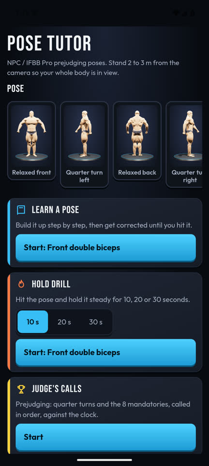
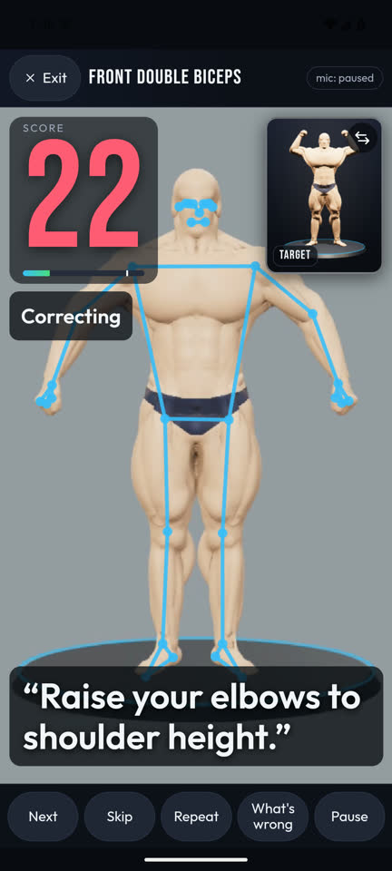

# Pose Tutor

Pose Tutor is an Android app that coaches the 12 men's bodybuilding prejudging poses: the 4 quarter turns and the 8 mandatory poses, as NPC and the IFBB Pro League call them. Stand the phone upright 2 to 3 m away. The front camera tracks your body, the app scores the pose from 0 to 100 and speaks the most important correction, and a 3D figure shows the target pose.

<p>
  
  
</p>

There are five modes:

- **Learn a pose** builds the pose up in 8 short steps, then corrects you until you hold it for 3 seconds.
- **Hold drill** times a steady hold of 10, 20 or 30 seconds and reports the mean score and the steadiness.
- **Judge's calls** runs a prejudging round in order, with 25 seconds for each call, and keeps your best round.
- **Mirror** makes the figure copy your body live, with no score.
- **Progress** keeps a photo of every hit pose and shows a timeline, a before and after compare, and a score trend.

During a run, you can say "next", "repeat", "what's wrong", "pause", "resume", "skip" or "stop". On a phone with Gemini Nano, a coach can look at the photo of each hit and add a short note.

## Install on a Pixel

The app needs Android 8.0 or later. The coach note needs a phone with Gemini Nano on AICore, such as a recent Pixel. The APK is debug-signed and is not in the Play Store.

1. Build the APKs (see the next section), or get `app-arm64-v8a-debug.apk` from someone who built it.
2. On the phone, turn on developer options and USB debugging, then connect it with USB.
3. Run `npm run android:install`. If more than one device is connected, set `ANDROID_SERIAL` to the phone's serial first.

You can also copy `app-arm64-v8a-debug.apk` to the phone and open it there. Android then asks you to allow installs from that app.

To use voice commands with free phrases, paste a TypeSafe API key in Settings. Without a key, the app uses keywords.

## Build from source

You need Node 22 or later, JDK 21 and the Android SDK. `scripts/android/setup-toolchain.sh` installs JDK 21 and the SDK in your home folder (`~/.local/jdk-21` and `~/Android/Sdk`).

```sh
npm ci
npm run fetch-model      # downloads the MediaPipe pose model into the Android assets and checks its SHA-256
npm run android:build    # writes the debug APKs to android/app/build/outputs/apk/debug/
```

`npm run figure` rebuilds the 3D figure in `public/figure/`. It needs Bun.

`npm run android:emulator` starts a local emulator, and `scripts/android/emulator.sh stop` stops it.

## Checks

| Command | What it checks |
|---|---|
| `npm run check` | Lint, typecheck, the unit tests, and a check that the paths and commands in the docs exist. It needs no device and takes about 2 seconds. CI runs it on every push. |
| `npm run android:lint` | Android lint on the Kotlin and Java code, after `npm run android:build`. CI runs it. |
| `npm run check:android` | The device checks below, in order, on an emulator that the script starts and stops. It takes about 8 minutes, plus the APK build. |
| `npm run android:gate` | Renders every pose with the figure and tracks it with the app's native plugin. It passes when every check passes and each pose scores within 5 points of `src/gate/baseline.json`. Report: [docs/gate-report.md](docs/gate-report.md). |
| `npm run android:e2e` | Runs every mode on the emulator with videos of the figure as the camera, and checks speech, voice commands, the coach and the network. It reads the TypeSafe key from `TYPESAFE_API_KEY` or `.env.local`. Report: [docs/e2e-report.md](docs/e2e-report.md). |
| `npm run android:native-check` | The coach and secret-store plugins. Report: [docs/native-report.md](docs/native-report.md). |
| `npm run android:phone-shots` | The phone layout in portrait and landscape, Settings, and keep-awake. Report: [docs/phone-report.md](docs/phone-report.md). |

[docs/pose-spec.md](docs/pose-spec.md) holds the research behind the scoring: the federation rules, measured landmark ranges, faults, cues and sources. [AGENTS.md](AGENTS.md) is the guide for code changes.

## What leaves the phone

The app shows the same list in Settings.

- The camera video, the tracked landmarks, the coach's input and your progress photos stay on the phone, in the app's private storage, with no cloud backup. Uninstalling the app deletes the photos.
- The coach (Gemini Nano) reads the photo and the scores on the phone. Nothing goes to a server.
- Speech recognition runs on the phone when it can. If it cannot, Android's speech service can send the audio to Google.
- With a TypeSafe key saved, the recognized text of each command goes to jev (`api.typesafe.ai`). The key stays in the Android Keystore.
- With a network voice chosen for the spoken cues, the cue text goes to Google. A local voice speaks on the phone.
- MediaPipe and ML Kit send usage statistics to Google (`firebaselogging.googleapis.com`): the library version, the app name, the device model and Android version, the country and language, and a random ID. They send no photos, prompts, coach replies or scores.

## Known limits

- The app tracks one person, from one camera, in 2D. It cannot measure depth, so it does not score lat flare, a forward elbow, a lean or a hidden wrist. On phones with Gemini Nano, the coach gets these points as hints for its note.
- The pass bands are estimates. They come from rulebooks, coaching sources and landmark measurements on 26 reference photos, with 1 to 3 photos per pose.
- The scoring follows NPC and IFBB Pro League conventions. Other federations differ in some feet, stance and turn details.
- The voice, the cues and the commands are English only.
- The coach note works only on phones with Gemini Nano. On other phones, the app says the coach is not available.
- The emulator checks use a rendered figure, not a person. A phone with a real body can score differently.

## License

MIT
